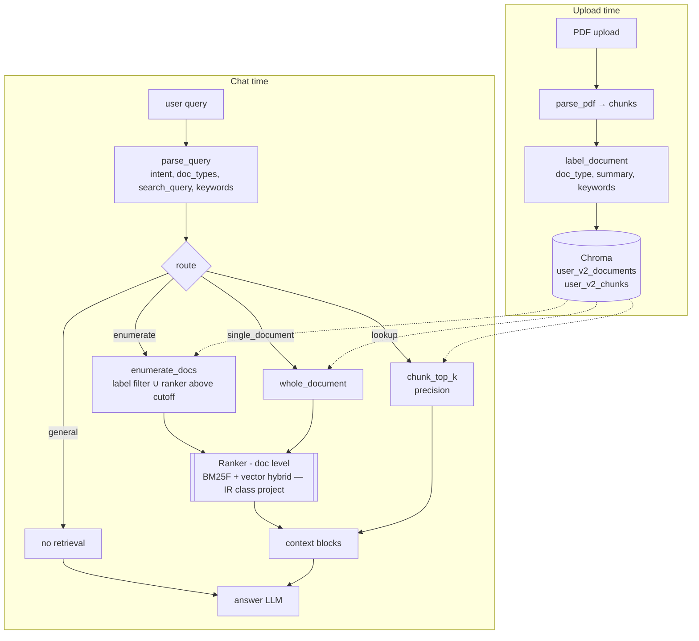

# DocsAI v2 — Retrieval Architecture (outline)

**Problem:** v1 returns the top 3 chunks by embedding similarity. That works for precision queries
("what's my gpa"), but fails coverage queries ("all my recipes", "all my prescriptions").
**v2:** route each query to a strategy, then rank *documents*, not only chunks.

## Flow

## Modules (`retrieval/`)

| File | Role | Status |
|---|---|---|
| `taxonomy.py` | Shared label vocabulary (DocType → Category) used by both labeler and parser | done |
| `schemas.py` | Data types: DocumentRecord, ParsedQuery, RoutePlan, ContextBlock… | done |
| `rankers/base.py` | `Ranker` interface — the plug-in point for the class ranking model | done |
| `labeler.py` | Ingest-time doc labeling (LLM) | stub |
| `query_parser.py` | Query → ParsedQuery (LLM) | stub |
| `router.py` | ParsedQuery → strategy (pure function) | stub |
| `store.py` | v2 Chroma layout: document collection + chunk collection | stub |
| `strategies.py` | One retrieval strategy per route | stub |
| `pipeline.py` | `ingest_document()` / `retrieve()` entry points | stub |

## Storage change

v1 has one collection per user, and a "document" is only a `title` string on the chunks. v2 adds:

- `{user}_v2_documents` — one row per doc (id = `doc_id`), with an embedding of the "doc card" (title + summary + keywords) and the labels in metadata.
- `{user}_v2_chunks` — chunks with `doc_id` + `doc_type` in metadata.

v1's `{user}_docs` stays as-is until migration is done.

## Ranker contract

The ranker is a pure function over in-memory candidates (no DB access). It receives named fields
(title, doc_type, summary, keywords, entities, optional body) plus a doc embedding. Scores must
work against a fixed threshold, because enumeration uses a cutoff rather than top-k.

The ranker works on **documents**, so only `enumerate` and `single_document` use it. `lookup` works on
**chunks** (vector top-k, as in v1). A later improvement for lookup would be a separate chunk-level
hybrid (BM25 + vector) to catch exact terms like IDs or drug names.

## Suggested order

1. Labeler and query parser, plus a small set of example queries with expected intents
2. Router
3. Store, plus dual-writing on `/add`
4. Strategies, with a vector baseline ranker
5. Backfill existing docs and switch `/chat` behind a flag
6. Bring in the BM25F / hybrid ranker; measure recall/precision against the baseline

## Open questions

- Multi-item docs (a cookbook PDF with 20 recipes): the document as the unit of retrieval isn't enough.
- Guests: their docs live in the in-memory Chroma client, so they need the same v2 layout there.
